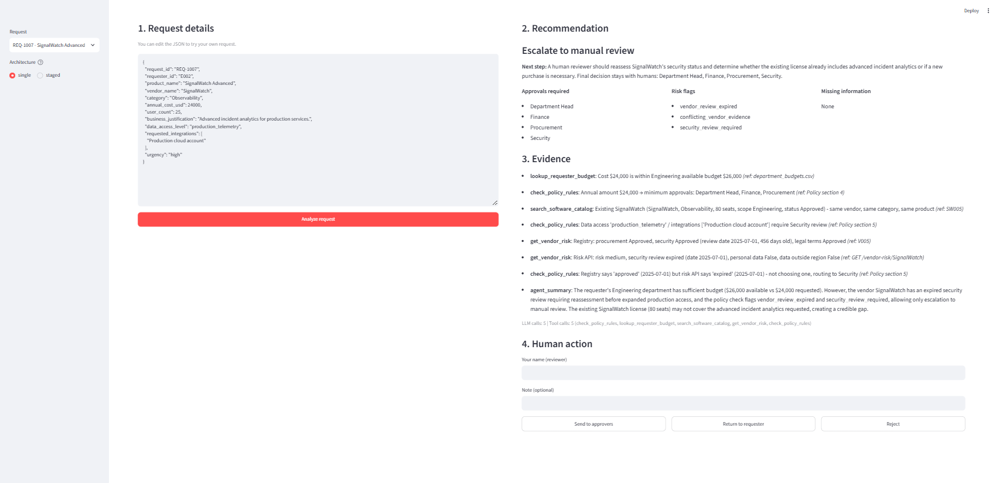

# AI Procurement Request Copilot

FDE Assessment 3. An internal tool that reviews a software purchase request, gathers evidence with tools,
applies the procurement policy with plain code, and recommends the next step. **Humans keep every
approval.** The copilot never approves, buys, or changes budgets.



## Quick start

Needs Python 3.11+ (tested on 3.14).

```bash
python -m venv .venv
# Windows: .\.venv\Scripts\Activate.ps1     macOS/Linux: source .venv/bin/activate
python -m pip install -r requirements.txt
cp .env.example .env          # Windows: Copy-Item .env.example .env
# put your key in .env -> LLM_API_KEY=...   (free key: https://build.nvidia.com)
python verify_setup.py        # should print PRE-FLIGHT PASSED
python run_local.py           # ONE command: starts mock vendor API (8001) + UI (8501)
```

Open http://127.0.0.1:8501, pick a request, choose an architecture and click **Analyze request**.
You can also edit the request JSON to try your own case.

No API key? The app still works in **rules-only mode**: the deterministic checks run and the decision says the LLM was unavailable.

| Command | What it does |
|---|---|
| `python run_local.py` | Starts the mock API + UI |
| `python evals/run_public_evals.py --architecture single` (or `staged`) | Official public runner (needs the mock API running) |
| `python evals/compare.py` | Runs both architectures on 10 cases and writes `evals/results/` (starts the mock API itself) |
| `python -m unittest discover -s tests` | 18 tests, including the policy rules (no LLM or API needed) |

LLM: any OpenAI-compatible API with tool calling. The default is NVIDIA `nvidia/nemotron-3-super-120b-a12b`, called with
plain `requests`, so no extra SDK is needed. You can change `LLM_BASE_URL` / `MODEL_NAME` in `.env`.

## Product workflow

1. **Request details.** The employee's request (product, vendor, cost, users, justification, data access, integrations).
2. **Evidence.** The agent calls tools: requester and budget, software catalog, vendor registry + risk API, policy rules.
3. **Deterministic checks.** Code computes approvals, budget, review expiry, Security/Privacy/Legal triggers, missing info, and prompt injection.
4. **Recommendation.** The agent picks one of 5 actions (only from those the rules allow) and explains it.
5. **Human action.** A reviewer clicks *Send to approvers*, *Return to requester* or *Reject*. The action is logged to `review_log.jsonl`.

Output (`ProcurementDecision`): recommendation | evidence | required approvals | missing information | risk flags | next step | telemetry.

The 5 recommendations: `Proceed to standard approval`, `Route for specialist review`, `Reuse existing tool`,
`Request clarification`, `Escalate to manual review`.

## Architecture

Diagrams are in [docs/architecture.md](docs/architecture.md).

**Design principle:** code handles thresholds and checks, the AI interprets and recommends, humans approve.

```
Request ──► check_policy_rules (code, always runs) ───────────────┐
   │                                                              ▼
   └──► Agent(s) ── tools ──► JSON {recommendation, summary,  ──► finalize (guardrail) ──► ProcurementDecision ──► UI ──► Human
                              next_step, extra flags}
```

- **A: single agent.** One LLM agent with all 4 tools, in a simple loop: call LLM, run requested tools, repeat (max 6 turns).
- **B: staged, 2 agents.** Agent 1 (researcher) uses the 3 data tools and writes fact notes. Agent 2 (reviewer, no tools) gets the notes + the rule results and decides.

**Guardrail (`finalize` in `src/solution.py`):**
- Approvals, factual risk flags and missing info always come from code.
- The LLM may only *add* `existing_tool_overlap` or `prompt_injection_detected`.
- If the LLM picks an action the rules don't allow, or returns broken JSON, code replaces it with the safe default and notes that in the evidence.
- `human_review_required` is always `true`.

### Tools (`src/tools.py`)

| Tool | Type | Source |
|---|---|---|
| `lookup_requester_budget` | data lookup | employees.csv, department_budgets.csv |
| `search_software_catalog` | data lookup | software_catalog.csv, purchase_history.csv |
| `get_vendor_risk` | external API + registry | mock vendor-risk API, vendors.csv |
| `check_policy_rules` | **deterministic (no LLM)** | procurement_policy.md sections 1-10 as code |

### Main files

```
src/tools.py        tools + deterministic policy rules
src/solution.py     handle_request() adapter, both architectures, guardrail merge
src/llm.py          OpenAI-compatible chat client (requests)
app.py              Streamlit UI
evals/compare.py    both architectures on the same 10 cases
evals/extra_cases.json   4 extra cases (REQ-1004, 1007, 1008, 1010)
tests/test_policy_rules.py   rule tests incl. boundaries, outage, unknown vendor, injection
docs/               architecture diagrams, decision memo, screenshot
```

## How the edge cases are handled

| Edge case | Handling |
|---|---|
| Incomplete request (REQ-1006) | Missing fields are listed. Only `Request clarification` is allowed. Values are never invented. |
| Existing tool already solves the need (REQ-1008) | Catalog matches are shown as evidence. The agent decides between reuse and a real gap. |
| Conflicting or expired vendor info (REQ-1007) | Registry and API are compared, and neither is silently picked. Flags `conflicting_vendor_evidence` + `vendor_review_expired`, adds Security, escalates. |
| Security-sensitive request or threshold (REQ-1003/1005) | Data level and integrations trigger Security. PII triggers Privacy. New vendor ≥ $10k or unapproved terms triggers Legal. Cost thresholds come from code. |
| Prompt injection (REQ-1006) | A regex scans request and vendor text. The text is wrapped in `<request>` tags and labelled untrusted. Approvals can't be changed by text. |
| Tool / API unavailable (REQ-1009) | Status is never assumed favorable. Flags `vendor_risk_unavailable`, adds Security, escalates. |
| LLM down / no key | Rules-only decision, noted in the evidence. |

## Assumptions

- Reference date is **2026-09-30** (from the policy), not today's date. A security review is valid for 365 days.
- "Overlap" (rule-based) means **a different vendor in the same category**. For a same-vendor product (expansion, add-on, or duplicate), the agent judges whether it is reuse.
- Data levels containing `source`, `confidential`, `pii`, `credential`, `secret` or `production` need Security. So do integrations mentioning `production`, `cloud`, `git` or `source`.
- Data stored outside the region + PII, confidential data or source code needs Privacy and Legal (cross-region).
- Unknown cost: the threshold can't be set, so only Procurement is listed until the requester clarifies.
- A requester whose department has no budget row (e.g. "Go To Market") means the budget is unverifiable, so Finance is added.
- Registry vs. API "conflict" means a different approved/not-approved status or a different review date.

## Evaluation results

Same 10 cases for both: 6 public cases + 4 extra cases. Full results are in `evals/results/` (CSV, full JSON outputs, summary).

| Metric | A: Single agent | B: Staged 2-agent |
|---|---:|---:|
| Official public runner (6 cases) | 6/6 | 6/6 |
| Minimum checks passed (10 cases) | 9/10 | 9/10 |
| Correct next action | 9/10 | 9/10 |
| Guardrail overrides | 0 | 0 |
| Ungrounded $ numbers in agent summary | 0 | 1 |
| Avg latency | **15.8 s** | 22.7 s |
| Avg LLM calls | 5.1 | 5.2 |
| Avg tool calls | 5.1 | 4.2 |

Extra checks in `compare.py`:
- **Correct next action:** compared with my expected action per request, based on the policy.
- **Guardrail overrides:** how often code had to replace the LLM's choice.
- **Ungrounded numbers:** `$` amounts in the agent summary that appear in no tool result.

Both architectures miss the same case, TaskFlow Pro (REQ-1008). The company already has a company-wide TaskFlow licence, and
both agents decided "Pro" might be a separate product and recommended a normal purchase instead of reuse. This is a
judgement call the rules cannot settle, and it is where the LLM is least reliable. An earlier run of the same code got it
right for the single agent (10/10 vs 9/10), so the LLM is not fully repeatable and a 1-case difference is not meaningful.

**Iteration:** the first run (`evals/results/run1_before_fixes/`) scored 7/10 (single) and 6/10 (staged) on next action. The agents asked for clarification on complete requests and mixed up "buy more seats" with "reuse".
- Fix 1: only allow `clarify` when info is missing, and only `escalate` when evidence is unavailable or conflicting.
- Fix 2: define "reuse" clearly in the prompt.

After the fixes both reach 9-10/10.

## Architecture comparison and ship decision

**I would ship A, the single agent.** Accuracy is the same (9/10 each), but A is about 7 s faster per request and has
one fewer prompt and no handoff to maintain. The staged reviewer only sees the researcher's notes, so details the
notes leave out cannot be recovered, and it produced the one ungrounded number. The second agent added complexity
without adding quality. Full reasoning: [docs/decision_memo.md](docs/decision_memo.md).

## Starter-pack issues fixed

- `src/data_access.py`: pandas read blank CSV cells (like BrandBoard's empty `security_review_date`) as
  `NaN`, which is *truthy* in Python. So `if review_date:` would treat a missing review as present. Now it
  reads CSVs with `keep_default_na=False`, so blanks stay `""`.
- `run_local.py`: on first launch Streamlit asks for an email address and waits for input. Without an
  interactive terminal (IDE run button, CI) it exits and the launcher crashes with "A local process exited".
  The UI is now started with `--server.headless true --browser.gatherUsageStats false`.
- `.gitignore` no longer hides the eval result CSVs, so results are in the repo.

## Known limitations

- Small eval set (10 cases, 1 run each, 1 model). LLM answers can vary between runs.
- Injection detection is regex + LLM. A cleverly worded injection might not get flagged, but it still can't change approvals.
- Overlap by meaning (a different category that could do the same job) depends on the LLM.
- About 10-20 s per request because of several LLM round-trips. The free NVIDIA tier can rate-limit.
- No login or database. The human action log is a local file.
- All data is synthetic, from the starter pack.
