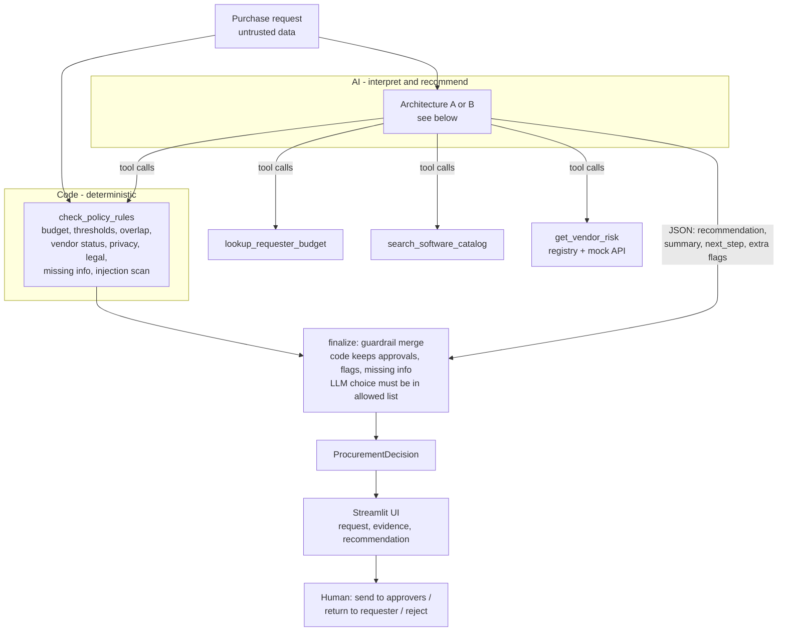
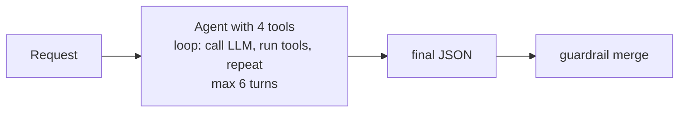
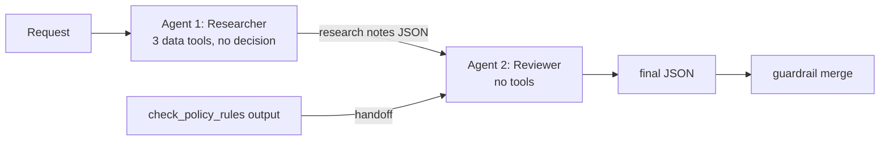

# Architecture and workflow

## Workflow (both architectures)

## Architecture A - single agent

## Architecture B - staged, 2 agents

Handoff format from Agent 1 to Agent 2: `{"facts": [...], "overlap_notes": "...", "concerns": [...]}`
plus the rule results `{required_approvals, risk_flags, missing_information, allowed_recommendations}`.

## Who decides what

| Decision | Owner | Why |
|---|---|---|
| Approval thresholds, budget check, review dates (365 days from 2026-09-30) | Code | Must be exact and repeatable |
| Security / Privacy / Legal triggers, registry-vs-API conflict, API outage | Code | Policy rules, no judgement needed |
| Missing required fields, prompt-injection pattern scan | Code | Cheap and reliable |
| Does an existing tool already cover the need? | LLM | Needs reading the justification |
| Which allowed recommendation fits, summary, next step wording | LLM | Interpretation |
| Approve, buy, budget exceptions, override reviews | Human | Policy section 11 |

## Stop / escalation conditions

- Missing required info -> only `Request clarification` is allowed.
- Vendor-risk API down or registry and API disagree -> `Escalate to manual review` (or route), plus Security.
- Any Security/Privacy/Legal/Finance-exception trigger -> `Proceed` is not allowed.
- LLM fails (no key, timeout, rate limit) -> rules-only decision, noted in the evidence.
- Agent loop is capped at 6 LLM turns.
- `human_review_required` is always `true`.

## Intentionally not built

- No agent framework (LangChain etc.): one short loop is easier to read and debug.
- No vector search: the catalog is 10 rows, so exact vendor/category matching is enough.
- No database or login: the human action log is a local `review_log.jsonl` file.
- No more than 2 agents (brief's recommended maximum).
